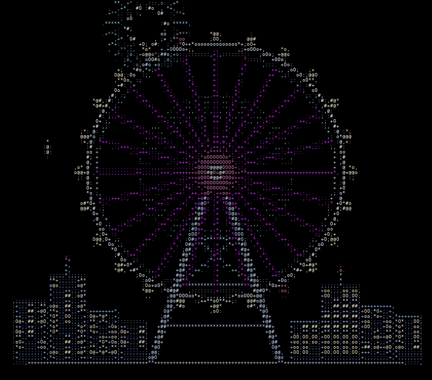

<picture>
    <source media= "(prefers-color-scheme: light)" srcset="assets/ferris-wheel-light.gif">
    <source media= "(prefers-color-scheme: dark)" srcset="assets/ferris-wheel-dark.gif">
    
</picture>

# Hi there! 👋

🐱 I'm a beginner developer and a proud cat parent.
🎓 Studying Computer Security Engineering at Myongji College

## 📚 Currently Learning
- Java
- Python
- C
- Computer Security

## 🌱 Goals
- Code a little every day
- Learn more about security

## 📂 Study Log
- [study-log](https://github.com/kwoojin1218/study-log)
